<p align="center">
  
</p>

<p align="center">An agent skill that plays Reviewer 2 on your LaTeX paper, before the real one does.</p>

<p align="center">
  <a href="LICENSE"></a>
  <a href="https://agentskills.io"></a>
  <a href="#-contributing"></a>
</p>

<p align="center">
  <a href="#-use">Use</a> ·
  <a href="#-install">Install</a> ·
  <a href="#-what-it-checks">What it checks</a> ·
  <a href="#-how-well-does-it-work">How well it works</a> ·
  <a href="#-good-to-know">Good to know</a> ·
  <a href="#-contact">Contact</a>
</p>

<p align="center">
  
</p>

Every author has met Reviewer 2: the one who decides in two minutes and spends the rest of the review looking for pretexts. Too many pages, a name in the PDF metadata, a number in the abstract that does not match a table, "just engineering", "why not compare with my system?".

This skill finds those objective errors before Reviewer 2 does, gives you one numbered report with the evidence and the fix for each, and can apply the fixes for you.

The repo is full of jokes, but the skill is a serious attempt at a useful tool. If you have improvements (or more jokes), contributions are welcome.

## 🚀 Use

<p align="center">
  
</p>

1. **Install**, once: run the [one-line command](#-install) (or install the Claude Code plugin), then ask your agent *"Set up reviewer2-repellent following its SETUP.md"* to [set up the tools](#set-up-the-tools). It installs nothing without your yes.

2. **Run.** Open your agent in the folder of your paper and ask:

   > Run Reviewer 2 on my paper. It goes to SIGIR 2027.

   (As a Claude Code plugin the command is `/reviewer2-repellent:reviewer2-repellent`.) It reads the venue's call for papers, compiles a copy of your paper and runs its checks in parallel ([what it checks](#-what-it-checks)). Then it shows you the report and asks you, in one message, the questions only you can answer (which of two numbers is right, facts about your work it cannot check); once you have answered, it builds `changes.pdf` and `corrected/`. Say *"report only"* to stop after the report. Everything goes to `reviewer2-repellent/<date>/` in your paper's folder:
   - `report.md`: every item numbered, with its location, evidence and fix;
   - `changes.pdf`: your paper with every change marked;
   - `corrected/`: a copy of your sources with the changes applied.

3. **Choose, in `changes.pdf`** (it opens by itself). Page 1 sums up the numbers and explains how to apply; the next pages are thematic: *Venue rules — Avoid Desk Reject*, *Check Bibliography — Avoid Easy Reject for Wrong References*, *Decisions for you*, *What we checked*, *Traces of AI use*. Then comes your paper, with every change marked by its item number: red for fixes, orange for those you must confirm, purple for optional wording, light-blue notes in the margin for the harder ones. Each change has a box: ☑ it will be applied, ☐ it will not. The boxes are pre-set by how sure the check is; click to change them, then save the PDF.

4. **Apply.** Ask your agent:

   > Apply my choices in reviewer2-repellent/&lt;date&gt;/changes.pdf

   `corrected/` then holds exactly the changes you ticked. Copy it over your sources.

5. **Present** the accepted paper at the conference.

## 📦 Install

One line, for the agent CLIs on your machine (Claude Code through `~/.claude/skills`; Codex, Gemini CLI and others that read `~/.agents/skills`; Antigravity):

```bash
curl -fsSL https://raw.githubusercontent.com/rossanoventurini/reviewer2-repellent/main/install.sh | bash
```

It clones the repo into `~/.local/share/reviewer2-repellent` and links the skill into `~/.claude/skills/` and `~/.agents/skills/` (and `~/.gemini/antigravity-cli/skills/` if Antigravity is installed). Run it again to update; add `--uninstall` to remove it (`curl ... | bash -s -- --uninstall`).

<details>
<summary><b>Other ways to install</b></summary>

| Tool | Command |
|---|---|
| Claude Code plugin | `/plugin install reviewer2-repellent --marketplace rossanoventurini/reviewer2-repellent` (Claude Code ≥ 2.1.275; on older versions `/plugin marketplace add rossanoventurini/reviewer2-repellent`, then `/plugin install reviewer2-repellent@reviewer2-repellent`) |
| [`npx skills`](https://github.com/vercel-labs/skills) | `npx skills add rossanoventurini/reviewer2-repellent -g` |
| [`gh skill`](https://github.blog/changelog/2026-04-16-manage-agent-skills-with-github-cli/) (GitHub CLI ≥ 2.90) | `gh skill install rossanoventurini/reviewer2-repellent reviewer2-repellent --agent claude-code --scope user` |
| From a clone | `git clone https://github.com/rossanoventurini/reviewer2-repellent && ./reviewer2-repellent/install.sh` |

Tested so far: `install.sh`, piped and from a clone, on macOS with Claude Code. The plugin, `npx skills` and `gh skill` routes are untested until the repository is public. Use one route only: two installs give your agent two copies of the skill.

</details>

### Set up the tools

The easiest way is to ask your agent:

> Set up reviewer2-repellent following its SETUP.md.

It runs `check_setup.py`, shows you the commands for what is missing, and installs nothing without your yes.

> [!NOTE]
> **Requirements and sizes.** Python ≥ 3.9 (standard library only), poppler (`pdftotext` & co.) and a TeX distribution with `latexmk` and a few common packages. TeX is the big one: BasicTeX plus the packages ~0.5-1 GB, the Debian/Ubuntu packages below ~1-1.5 GB (`texlive-full` is not needed), a full TeX Live / MacTeX 9.7 GB. Optional: RefChecker with its local DBLP database (4.6 GB, built once in ~20 min) and two MCP servers run by `uvx`. Details in [SETUP.md](skills/reviewer2-repellent/SETUP.md#requirements-and-sizes).

Or install the tools yourself ([all systems](skills/reviewer2-repellent/SETUP.md#installing-tex-and-poppler-by-system)):

```bash
# macOS, light (then open a new terminal)
brew install --cask basictex && brew install poppler
sudo tlmgr update --self
sudo tlmgr install latexmk ulem xcolor hyperref pgf widows-and-orphans animate zref ocgx2 media9

# Debian/Ubuntu
sudo apt-get install texlive-latex-extra texlive-fonts-recommended texlive-bibtex-extra texlive-plain-generic texlive-pictures biber latexmk poppler-utils python3
```

**Windows:** use WSL (`wsl --install` gives Ubuntu), follow the Debian/Ubuntu line inside it and run the agent inside WSL too.

Then check the setup and run the self-test (about 15 s offline; `--network` also checks two references online, about 30 s in all, longer when arXiv is slow). With the one-line install the skill lives in `~/.local/share/reviewer2-repellent`; from a clone or the plugin, use the same scripts in the skill's `scripts/` folder:

```bash
python3 ~/.local/share/reviewer2-repellent/skills/reviewer2-repellent/scripts/check_setup.py
python3 ~/.local/share/reviewer2-repellent/skills/reviewer2-repellent/scripts/self_test.py --network
```

## 🔎 What it checks

Errors that can be verified, not opinions on your research. Several checkers read the paper independently, scripts measure what can be measured, and a merge step cross-checks everything into one numbered report. The themes follow the pages of `changes.pdf`:

| | Theme | What is checked, and how |
|:---:|---|---|
| 📏 | **Venue rules — Avoid Desk Reject** | The call or author guide of your venue, read on the web: page limit, anonymity, template, required statements, LLM-use statement; each rule quoted with its source |
| 📚 | **Check Bibliography — Avoid Easy Reject for Wrong References** | Every cited entry looked up in DBLP, Crossref, DOI or arXiv (authors, title, year, venue, pages); preprints that have a published version, duplicates, uniform style. Only reference metadata leaves your machine |
| 🔢 | **Numbers and claims — Avoid "the results do not support the claims"** | Text against tables and figures, recomputed averages and ratios, the same experiment reported identically, claims in abstract, introduction and conclusions against the results |
| ✏️ | **Typos and grammar — Avoid "the paper needs careful proofreading"** | A high-recall finder, then a verifier, on every sentence |
| 📊 | **Figures, tables, cross-references and notation — Avoid "sloppy presentation"** | Figures and tables, cross-references, consistent notation |
| 🧮 | **Build and layout — Avoid "formatting violations"** | LaTeX log, overfull boxes, fonts, broken links, floats |
| 🧹 | **Leftovers and source hygiene — Avoid "the authors did not even reread it"** | TODOs, notes, comments, hidden text, Markdown and Unicode pasted from a chat |
| 🤖 | **Traces of AI use — Avoid "written by ChatGPT"** | Only verifiable artifacts and your disclosure; style is never called evidence |

Not checked: the scientific merit (novelty, significance, missing experiments).

## 📈 How well does it work?

Measured on our own runs, so take the numbers as indicative:

- **Recall against a careful reader.** On 5 conference papers that we also used to tune the checkers (so these are development numbers, measured before the annotated PDF existed; a held-out evaluation is still to come), the combined checkers found 92% of the objective errors found by either the skill or a single careful-reading LLM agent given the same papers; that agent alone found 75%. False alarms were similar: 8 for the skill and 6 for the agent, out of about 600 items.
- **Real reviewers.** It caught all 11 problems of this kind that the papers' real reviewers raised (the single agent: 10).
- **Typos.** On 35 errors that authors later fixed between two arXiv versions of 5 papers, the two-stage typos checker recovered 32 to 34, depending on the run (a single typos agent: 26); on 12 such errors in 10 other papers, 11 (the single agent: 7).
- **Scripts.** Every script is tested on synthetic, adversarial fixtures ([`evals/tests/`](evals/tests/)).

How these numbers were measured, with the per-paper counts and the limits: [evals/README.md](evals/README.md).

Not measured: the precision of every single checker on papers it has never seen. Treat each item as a suggestion to verify, which is why every change has its evidence, its location and a box you can untick.

## 🧭 How it differs

Pasting the paper into a chatbot gives you opinions mixed with errors, often without saying where they are. This skill reports only errors that can be verified, each with its evidence and location; it does not invent facts (when a fix needs one, it asks you); it reads the venue's rules from the call for papers itself; and it gives you a corrected copy and a PDF where you tick what to apply. Bibliography checkers such as [RefChecker](https://github.com/markrussinovich/refchecker) and LaTeX linters do one part of the job: the skill runs them when they are installed and adds the checkers that read the paper (numbers against tables, claims against results, typos, venue rules).

## 🧾 Good to know

Your sources are never modified unless you ask. Do not commit the `reviewer2-repellent/` folder or include it in your arXiv upload.

| | |
|---|---|
| 🗓️ **When** | When the paper is nearly ready to submit: content and results settled, all sections written. |
| 📄 **Input** | Your LaTeX sources and `.bib`. |
| ⏱️ **Cost and time** | Heavy: several subagents each read the whole paper, so it uses roughly 3× the tokens of a single careful-reading agent. A full run on a 41-page journal paper took about 2.5 h wall-clock, the author's answers included; on a 12-page conference paper the checks take about 20-30 min. Approximate figures, measured with Claude Code on macOS. |
| 🤖 **Agent** | One that can launch subagents and fetch web pages (Claude Code does both). Other CLIs run the checkers one after another, which is slower. |
| 💾 **Requirements and sizes** | Python, poppler and TeX (0.5-1.5 GB with the light setup, 9.7 GB for a full TeX Live); optional local DBLP 4.6 GB. See [Set up the tools](#set-up-the-tools). |
| 🔒 **Privacy** | Your paper goes only to your agent's own model. Reference metadata (titles, authors, identifiers) goes to DBLP, Crossref, DOI, arXiv, and, through RefChecker, OpenAlex, Semantic Scholar and the ACL Anthology. The URLs printed in your paper are fetched to test that they work (`--offline` skips this). The venue's name goes to a web search for its call for papers. |
| 💻 **Tested on** | macOS with Claude Code. Linux, WSL and the other agent CLIs are untested: reports are welcome (an issue with the output of `check_setup.py` and `self_test.py`). |
| 🧰 **Optional tools** | [RefChecker](https://github.com/markrussinovich/refchecker) with a local DBLP database, run without LLM keys; the DBLP and arXiv MCP servers; `exiftool` for names hidden in figure files. Without them the agent does the same checks itself. See [SETUP.md](skills/reviewer2-repellent/SETUP.md). |

## 🚫 What it will not do

- 🚫 **Judge your research**: novelty, significance and missing experiments are for your reviewers.
- 🚫 **Invent facts** or soften true results; when a number can be fixed in two ways, it asks you.
- 🚫 **Touch your sources** without being asked: fixes go to a copy.
- 🚫 **Hide text** or plant instructions for reviewers' LLMs in your paper (it checks that there is none).
- 🚫 **Send your unpublished paper** to another provider's model or tool without asking.

## 🤝 Contributing

PRs are welcome: new checks, venue rules, false alarms you met, or examples from your own (anonymized) runs. The skill is in [`skills/reviewer2-repellent/`](skills/reviewer2-repellent/SKILL.md); the scripts have tests in [`evals/tests/`](evals/tests/). See [CONTRIBUTING.md](CONTRIBUTING.md) for how to run the tests and add a check. To report a false alarm, [open an issue](https://github.com/rossanoventurini/reviewer2-repellent/issues/new/choose) with the quoted sentence and why it is wrong: never the whole paper.

If you use it in your work, [CITATION.cff](CITATION.cff) has the citation.

## 📬 Contact

**Rossano Venturini**, University of Pisa

<p>
  <a href="https://pages.di.unipi.it/rossano/"></a>
  <a href="mailto:rossano.venturini@gmail.com"></a>
  <a href="https://www.linkedin.com/in/rossano-venturini-ab043089/"></a>
  <a href="https://github.com/rossanoventurini"></a>
</p>

Found a bug or have an idea (or a better joke)? [Open an issue](https://github.com/rossanoventurini/reviewer2-repellent/issues).

## 📜 Licence

MIT, see [LICENSE](LICENSE).
